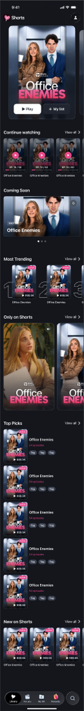
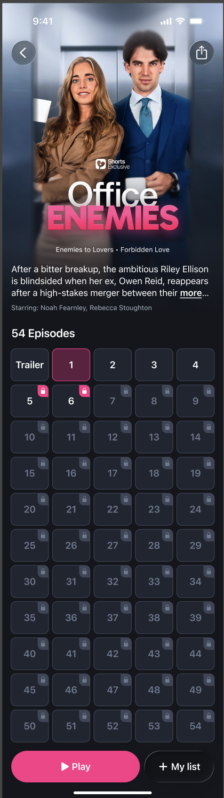

<h1 align="center">Shorts</h1>

<p align="center">
  A mini streaming app for short-form drama series, built with <b>SwiftUI</b> as an iOS hiring case study.
</p>

<p align="center">
  
  
  
  
</p>

> **What is this repo?** A take-home task I completed for a company's iOS hiring process (company not named). They gave me a Figma design and a set of cover images and asked for a small streaming app. This README explains the brief, what I built, and the decisions behind it, so you can understand the project without having seen the original task.

**Contents:** [The task](#the-task) · [What I built](#what-i-built) · [Architecture](#architecture) · [Key decisions](#key-decisions) · [How to run](#how-to-run) · [Time spent](#time-spent) · [Notes and trade-offs](#notes-and-trade-offs)

---

## The task

### At a glance

| | |
|---|---|
| **Goal** | Build a mini streaming app called *Shorts* |
| **Scope asked for** | Two screens, one navigation flow: Homepage and Series Detail |
| **Provided** | A Figma design file and a zip of series cover images |
| **Time limit** | One week, report roughly how many hours were spent |
| **Stack** | SwiftUI, MVVM, iOS 17+ minimum (tested on iOS 26+) |
| **Delivery** | Private repo plus a short README with time spent and decisions |

### Requirements

**Homepage**
- A carousel at the top
- Multiple content sections: series rows, coming soon, featured
- A persistent header with the logo and a tab bar

**Series Detail**
- Full-bleed cover image with an overlay
- Series info: tags, description, cast
- Episode picker grid
- Bottom toolbar with CTA actions

**Navigation** between the two screens should feel native and fluid.

### The one UI challenge

This was the only interaction the brief prescribed, everything else was left open:

> The Series Detail header needs a **parallax effect with a polished collapsing animation on scroll**. Be creative and make it smooth.

### Technical requirements

- Full SwiftUI (UIKit allowed but not required)
- MVVM used throughout
- iOS 17+ minimum deployment target, with testing on iOS 26+
- **Data layer:** how to load and structure the data was open-ended, with the guidance "be pragmatic, keep it simple, yet scalable"
- **AI tools:** allowed, with the rule that you own the code and must be able to explain it

### The closing line of the brief

> Have fun and deliver something you'd be proud to showcase on your App Store account.

### The design (Figma)

The design file provided with the task. The Homepage is a long scrolling feed, and the Series Detail screen has the parallax cover that the challenge is about.

| Homepage | Series Detail |
|---|---|
|  |  |


---

## What I built

The brief asked for two screens. I built those two, then filled out every tab in the design, because a showcase app with one working tab isn't much of a showcase.

| Screen | What it does |
|--------|--------------|
| **Homepage** | Hero carousel, continue watching with progress bars, a paged "coming soon" carousel, ranked trending, horizontal rows, top picks. Loading and error states with retry. |
| **Series Detail** | The parallax header with stretch and fade, expandable description, cast, season picker, episode grid with lock states, unlock paywall sheet, share button, add to My List |
| **For You** *(extra)* | Personalized grid scored by genre overlap with watch history and My List |
| **My List** *(extra)* | Persistent saved series (UserDefaults), remove with animation |
| **Search** *(extra)* | Live text search with genre chips, trending as the default state |
| **Rewards** *(extra)* | Daily check-in, promo banner, social follow rows (static UI to complete the tab) |

### How it maps to the brief

| Requirement | Where it lives |
|---|---|
| Carousel at the top | Hero carousel with scale and dim on the focused card |
| Multiple content sections | Continue watching, Coming soon, Most trending, Only on Shorts, Top picks, New on Shorts |
| Persistent header and tab bar | Logo header overlay and a custom pill tab bar |
| Full-bleed cover, info, episode grid, bottom bar | `SeriesDetailView` with its parallax header, episode grid and bottom toolbar |
| Native, fluid navigation | `NavigationStack` per tab with value-based links |
| Parallax and collapsing header | `ParallaxHeaderView`, driven by scroll offset |
| MVVM throughout | Every feature screen has its own `@Observable` ViewModel |
| Pragmatic, scalable data layer | Protocol-based repositories over a JSON file that mirrors a real API |

---

## Architecture

**MVVM** with protocol-based repositories and initializer-based dependency injection from the app root.

```
App/                    → Entry point, TabView, navigation
Features/
  Home/                 → Homepage with section-based feed
  SeriesDetail/         → Parallax header, episode grid, unlock sheet
  ForYou/               → Personalized recommendations based on watch history
  MyList/               → Saved series with persistence
  Search/               → Full-text search with genre filtering
  Rewards/              → Daily check-in, promo banners (static UI)
Models/                 → Series, HomepageSection, response DTOs
Repositories/           → SeriesRepository (async), MyListRepository (UserDefaults)
Utilities/              → Image loading, common views, button styles, modifiers
Resources/              → Design tokens (color, font, layout, motion), localization, mock data, assets
```

### Data flow

`MockData.json` mirrors a real API response: sections contain full series objects inline, with no client-side ID resolution. The repository simulates network latency, decodes off the main thread via `Task.detached`, and exposes typed `[HomepageSectionData]`. ViewModels own repositories passed in through `init`, and views read data through their ViewModel only.

### Concurrency

- Repositories and ViewModels are `@MainActor`, so shared state is only touched on the main actor
- Decoding runs in a detached task, and cancellation is forwarded to it with `withTaskCancellationHandler`
- A cancelled load (for example when a view disappears) is treated as control flow and not as an error
- The Home screen has explicit loading, content and error-with-retry states

### Design system

Small, shared building blocks keep the UI consistent: `Color+Theme`, `Font+Theme` (built on system text styles, so it supports Dynamic Type), `Layout+Theme` (spacing, grid and card tokens plus shared animation curves), reusable `ButtonStyle`s, and a `cardStyle` modifier for the poster look.

---

## Key decisions

- **No singletons.** Repositories and the image loader are created once in `ShortsApp` and injected. Repositories are passed through initializers, so a missing dependency is a compile error and not a silent default
- **`@Observable` only where needed.** `MyListRepository` is observable because several screens react to list changes. `SeriesRepository` is a plain class, and loading state lives in the ViewModels
- **Native `TabView` with a custom tab bar.** The system tab bar is hidden and a pill-shaped bar is drawn on top. Each tab has its own `NavigationStack`, so view state survives tab switches
- **Tab bar visibility is derived from navigation state.** Each stack owns a `NavigationStack(path:)` and the bar shows only while nothing is pushed, so there is no shared flag to get out of sync with swipe-back gestures
- **iOS 26 Liquid Glass** with `#available` checks and `.ultraThinMaterial` fallbacks, so the same UI works on iOS 17 and up
- **Local image loading.** The covers ship in the bundle and are mapped by slug through `SeriesImageLoader` (an `NSCache` of 100 items). In production I'd load them by URL with `AsyncImage` or a caching layer
- **Full localization.** Every user-facing string goes through `Localizable.strings` using typed `String` extensions
- **Zero dependencies.** Apple frameworks only

---

## How to run

1. Open `Shorts.xcodeproj` in Xcode 16 or later
2. Select an iOS 17+ simulator or device
3. Build and run

---

## Time spent

About **10 hours over 2 days** (the limit was one week).

---

## Notes and trade-offs

**Why the covers are bundled.** At first I wondered why the cover images were provided at all. Then I realised that pulling images from random URLs would make the app look inconsistent in quality and resolution. So I bundled them, wrote a `MockData.json` that simulates the response I'd expect from a backend, and mapped images by slug. In a real project those would be URLs from the backend, loaded with `AsyncImage` and some caching.

**SwiftUI navigation instead of coordinators.** For a small project I used plain SwiftUI navigation to avoid spending time on coordinator setup, which I'd normally reach for.

**Things I would improve**

- **Dependency injection and navigation.** Passing dependencies through view initializers works at this size but gets noisy. In a real app I'd use coordinators or a container-based injection approach
- **Tab bar.** I started with a custom tab bar to support Liquid Glass on both iOS 17+ and 26+, but tab views were recreated on every switch. The workaround is a hidden native `TabView` with the custom bar drawn on top. It works, but I'd spend more time on a cleaner solution
- **Performance.** Image decoding currently happens synchronously on first use. With larger data sets I'd decode and downsample off the main thread
- **Design fidelity.** I used SF Symbols instead of exporting every icon and asset from the design to save time, so some icons and details differ from the Figma file
- **Tests.** I judged them unnecessary for a task this size, but I'd add them on every real project, starting with the ViewModels and repositories
